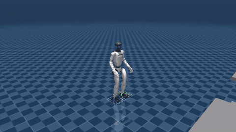
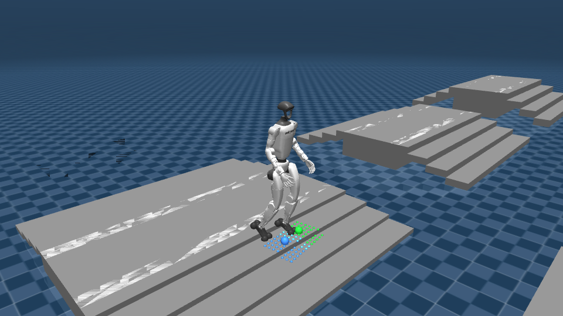
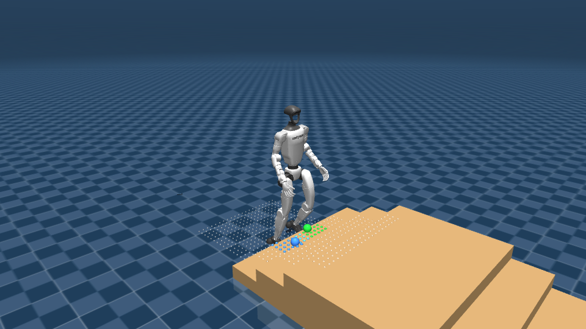
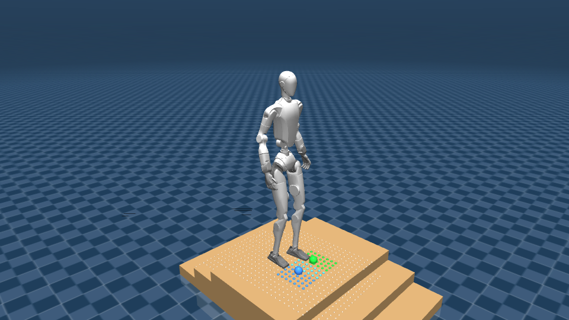

# Perceptive humanoid locomotion on the Unitree G1 — simulation demos

Visuals from my work on terrain-aware walking for the Unitree G1 (29 DoF) and H2 humanoids.
The controller is a foothold prediction model (FPM) policy in the style of
[leggedrobotics/foothold-prediction-model](https://github.com/leggedrobotics/foothold-prediction-model)
("Watch Your Step"): the robot predicts where its next two feet will land and looks at the terrain
only in two small height patches around those footholds.

This repository contains **media only**. The training, sim-to-sim and sim-to-real code is private.

## What the markers mean

- **Green sphere**: predicted left foothold. **Blue sphere**: predicted right foothold.
- **Green / blue dots**: the 7 x 7 grid of terrain heights (5 cm spacing, 35 x 35 cm) sampled around
  each foothold. These 98 values are the policy's entire view of the terrain.
- **White dots** (where shown): the full 1.6 x 1.0 m scanner area. The policy never sees these; they
  are drawn to show how little of the available terrain information the controller actually uses.

## G1 crossing the Hiking terrain course (MuJoCo)

16 s at a 0.5 m/s forward command: stairs up, a platform, stairs down. Rendered from the MuJoCo
sim-to-sim player with the foothold markers on. Full-resolution clip:
[media/g1_hiking_course.mp4](media/g1_hiking_course.mp4).

## Perception on stairs

  
  

Left: the G1 approaching a 11.5 cm staircase. The two height patches already sit on the first tread
before the foot gets there. Right: the same policy architecture on the 31 DoF Unitree H2.

## Foot placement fine-tuning

The G1 policy was fine-tuned with a penalty for footholds whose sole straddles a step edge.
Evaluated in Isaac Lab over 13 terrain types with 200 robots each, the share of loaded footsteps
on an edge dropped from 33 % to 14 % on pyramid stairs and from 43 % to 13 % on stepping stones,
with no extra falls on stairs or boxes. The trade-off is slower velocity tracking and less
robustness on sparse gap terrain, which is the next thing to tune.

## Credits

- Base method and demo policy: [leggedrobotics/foothold-prediction-model](https://github.com/leggedrobotics/foothold-prediction-model) (MIT).
- Robot models: Unitree Robotics. Simulation: MuJoCo and NVIDIA Isaac Lab.
